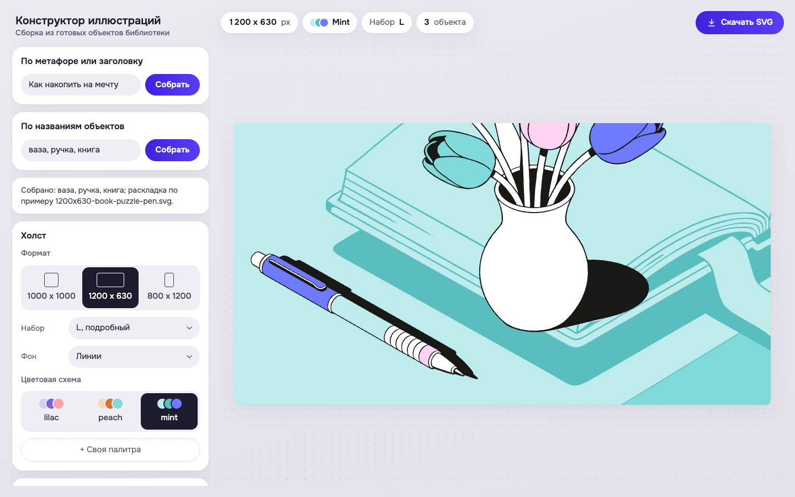
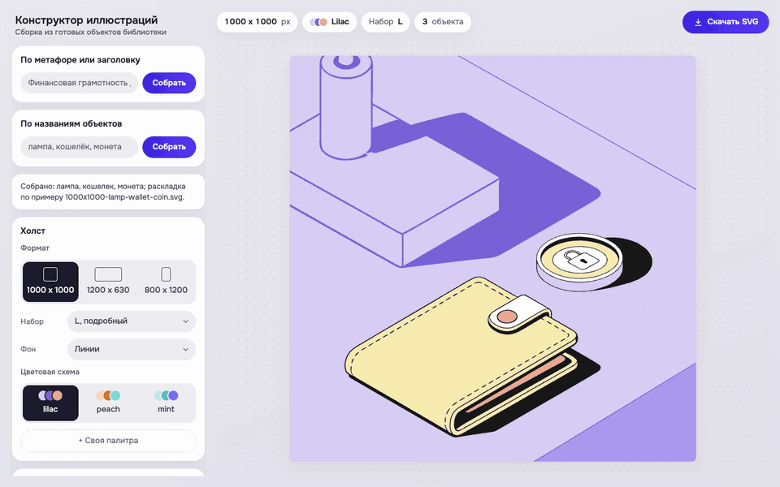
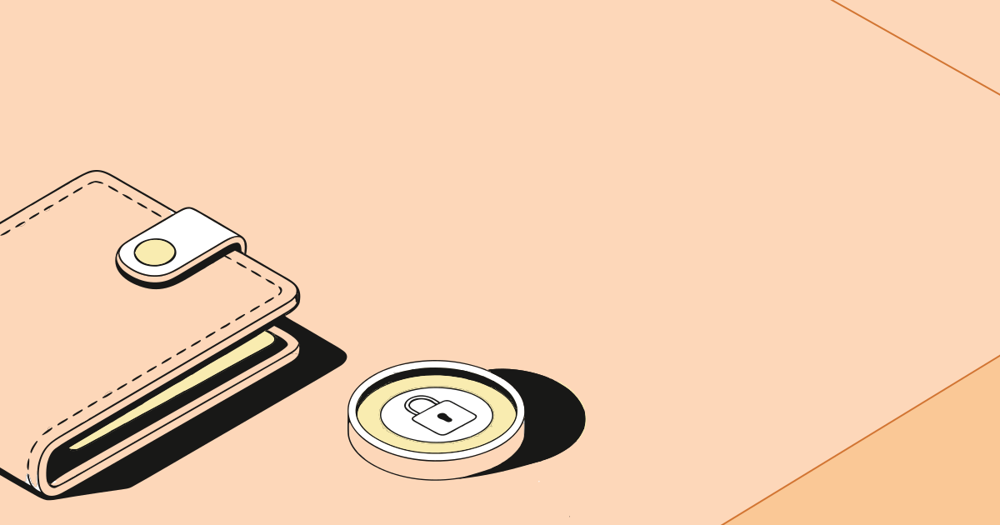
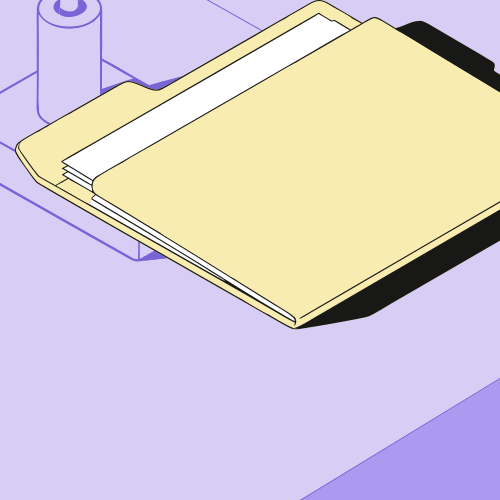
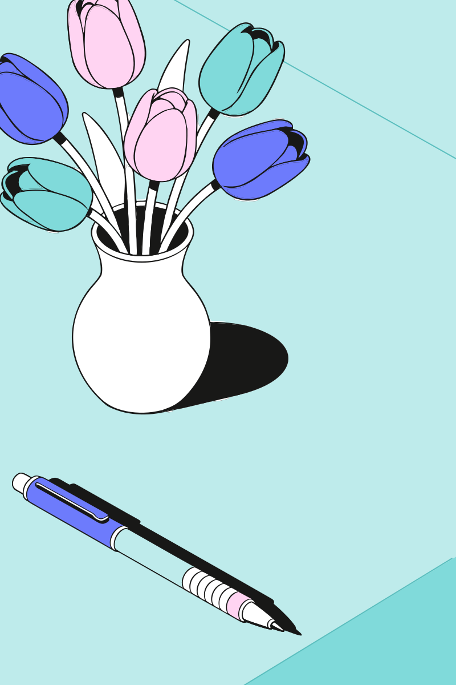

# Конструктор иллюстраций

Собирает векторные иллюстрации из готовых объектов библиотеки по фразе или по списку названий и отдаёт SVG.

**[Открыть демо](https://tz.pe4mnur7.online/web/)** · [Задание](docs/TZ.md) · [Архитектура](docs/ARCHITECTURE.md) · [Правила библиотеки](docs/RULES.md)



Новых объектов сервис не рисует. Каждая композиция - это объекты из библиотеки Figma
в исходной геометрии, расставленные по раскладкам из эталонных примеров и окрашенные
только цветами выбранной схемы.

## Содержание

- [Как это выглядит](#как-это-выглядит)
- [Возможности](#возможности)
- [Запуск](#запуск)
- [Как устроено](#как-устроено)
- [Примеры](#примеры)
- [Проверки](#проверки)
- [Что где](#что-где)
- [Инструменты разработки](#инструменты-разработки)

## Как это выглядит

Фраза "Как накопить на мечту" -> кошелёк, монета, лампа. Затем смена схемы, формата
холста и сборка по названиям "ваза, ручка, книга":



## Возможности

**Сценарий 1, по метафоре или заголовку.** Языковая модель выбирает из библиотеки
2-3 объекта под смысл фразы и объясняет выбор. Без ключа API фразу разбирает локальный
словарь ассоциаций.

**Сценарий 2, по названиям.** Объекты перечисляются через запятую, раскладка
подбирается по эталонному примеру с тем же числом объектов.

**Редактор.**

| Действие | Как |
|---|---|
| Двигать объект | тянуть мышью по холсту или стрелками (шаг 10 px, с Shift 50) |
| Повернуть | тянуть за угол рамки выделения, с Shift шаг 15°; клавиши [ и ] на 15° |
| Дублировать | Cmd/Ctrl+D или иконка в слоях |
| Удалить | Delete, Backspace или иконка в слоях |
| Порядок слоёв | перетащить строку в списке "Слои" или Alt+стрелка вверх/вниз |
| Отменить, повторить | Cmd/Ctrl+Z, Shift+Cmd/Ctrl+Z (или Ctrl+Y), кнопки над холстом |
| Скрыть, главный или фоновый | иконки в строке слоя |
| Холст | формат 1000 x 1000, 1200 x 630, 800 x 1200; набор L или S; вид фона |
| Цвет | схемы lilac, peach, mint или своя |

**Своя палитра.** Кнопка "+ Своя палитра" открывает редактор: название и 3 + 3 цвета
(фоновые и объектные), холст перекрашивается сразу. Тот же формат принимается файлом:

```json
{ "id": "sea", "background": ["#e8f4f8", "#b8dce8", "#7fb8cc"], "object": ["#ffd166", "#ef476f", "#118ab2"] }
```

**Экспорт.** "Скачать SVG" отдаёт чистый вектор: без растра, без рамки выделения
и скрытых слоёв, каждый объект отдельной группой с понятным id (`wallet-1`, `coin-1`).

> [!NOTE]
> Масштаба у отдельного объекта нет намеренно: пропорции объектов относительно друг
> друга - правило библиотеки. Разбор всех правил и того, как сервис их соблюдает, -
> в [docs/RULES.md](docs/RULES.md).

## Запуск

Нужен Node.js (проверено на 22 и 26), npm-зависимостей нет.

```bash
node server.mjs
```

Открыть http://localhost:8080. Другой порт: `node server.mjs 3000`.

Без ключа сервер только раздаёт файлы, и `web/`, `library/`, `examples/` работают
с любого статического хостинга, в том числе из подпапки.

<details>
<summary>Языковая модель для сценария 1</summary>

Подойдёт любой OpenAI-совместимый API:

```bash
LLM_API_KEY=... node server.mjs
```

| Переменная | Что задаёт | По умолчанию |
|---|---|---|
| `LLM_API_KEY` | ключ; без него работает словарь ассоциаций | не задан |
| `LLM_BASE_URL` | адрес API | `https://taynik.store/v1` |
| `LLM_MODELS` | модели через запятую, следующая пробуется при перегрузке или квоте | `orig/claude-haiku-5-5,gemini-3.8-flash` |
| `ALL_PROXY` | прокси для `curl`, например `socks5h://host:port` | не задан |

Для ключа Google: `LLM_BASE_URL=https://generativelanguage.googleapis.com/v1beta/openai`.

</details>

<details>
<summary>Docker</summary>

```bash
docker build -t illustration-composer .
docker run --env-file .env -p 8080:8080 illustration-composer
```

</details>

## Как устроено

```
library/*.svg ──> build-manifest.mjs ──> manifest.json
                                              │
palettes.json, examples/layouts.json ─────────┤
                                              v
                 web/app.js (интерфейс) ──> web/compose.js ──> SVG на холсте и в файл
```

- Цвет в объектах хранится ролями (`bg1..3`, `obj1..3`), а не hex. Смена схемы - замена
  таблицы "роль -> цвет", геометрия не трогается.
- Сборка манифеста падает, если файл библиотеки нарушает правила: цвет вне схемы,
  растр, объектный цвет у фона.
- Вся логика композиции - в `web/compose.js` без DOM: тот же модуль работает в браузере,
  в тестах и в скрипте примеров.

Подробно о хранении, извлечении и переиспользовании SVG - [docs/ARCHITECTURE.md](docs/ARCHITECTURE.md).

## Примеры

Три композиции, собранные сервисом, лежат в [examples/composed/](examples/composed/):

| По фразе, 1200 x 630, peach | По фразе, 1000 x 1000, lilac, набор S | По названиям, 800 x 1200, mint |
|:---:|:---:|:---:|
|  |  |  |

Пересобрать их: `node scripts/make-examples.mjs`.

## Проверки

```bash
node scripts/build-manifest.mjs && node scripts/test-compose.mjs
```

Первый скрипт проверяет библиотеку на правила, второй собирает все 18 эталонных
раскладок в двух наборах и трёх схемах и проверяет разбор фразы и палитры.

## Что где

| Путь | Что там |
|---|---|
| [web/](web/) | интерфейс (`index.html`, `app.js`) и логика без DOM (`compose.js`) |
| [server.mjs](server.mjs) | статика и `/api/metaphor` |
| [library/](library/) | 40 объектов и 6 фонов в SVG (наборы L и S, состояния main и background), `palettes.json`, `manifest.json` |
| [examples/](examples/) | эталоны из Figma: 18 SVG, 12 PNG, раскладки в `layouts.json` |
| [docs/TZ.md](docs/TZ.md) | текст задания |
| [docs/RULES.md](docs/RULES.md) | правила библиотеки и как сервис их соблюдает |
| [docs/LIBRARY.md](docs/LIBRARY.md) | библиотека по файлу Figma: объекты, id узлов, палитры |
| [docs/ARCHITECTURE.md](docs/ARCHITECTURE.md) | хранение SVG и алгоритм сборки |

Исходник библиотеки - файл Figma "Тестовое | иллюстрации", ключ `4MCFttsSoP7hgQh29zq5G3`,
читается через копию `2FainuemKZkOmg7kHyowFN`.

## Инструменты разработки

Весь проект написан в **Claude Code** на модели **Claude Opus 5.5** с уровнем рассуждений
**medium**. Других AI-инструментов при разработке не было.

Языковая модель внутри сервиса (сценарий 1) - отдельная часть продукта, а не инструмент
разработки: она задаётся переменной `LLM_MODELS` и меняется без правки кода.
